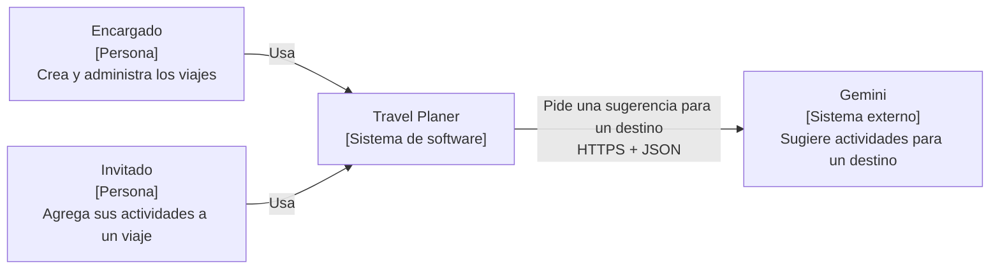
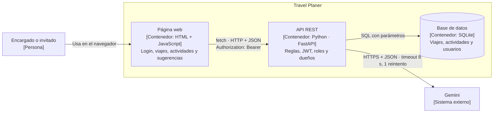

# Arquitectura

## Nivel 1 · Contexto

## Nivel 2 · Contenedores

La página se sirve con `python -m http.server 5500` y la API con `uvicorn` en el puerto 8000: son dos procesos distintos, por eso la API necesita CORS. Para las pruebas, `simulador.py` (puerto 9000) se pone en lugar de Gemini y puede fallar a propósito.

## Qué pasa si algo falla

| Si falla... | Qué responde la API | Por qué |
|---|---|---|
| Gemini tarda más de 8 segundos | 504 | La API no se queda esperando: avisa y no reintenta, porque ya se perdió mucho tiempo. |
| Gemini responde un error 5xx o no se puede conectar | Un reintento; si vuelve a fallar, 502 | Las fallas del servicio suelen ser pasajeras. |
| Gemini responde un error 4xx, o algo que no es JSON ni tiene la forma pedida | 502 | El problema es del otro servicio o de la petición; reintentar no lo arregla. |
| Falta `GEMINI_API_KEY` | 503 | El servicio no está configurado; el resto de la API sigue funcionando. |
| Falta `JWT_SECRETO` | La API no arranca | Sin secreto no se pueden firmar tokens y no se debe usar uno por omisión. |
| El token falta, es falso o ya expiró | 401 | La API no sabe quién hace la petición; hay que volver a entrar en `/login`. |
| La página viene de un origen que no está en la lista | El navegador bloquea | CORS protege al usuario de páginas ajenas. |
